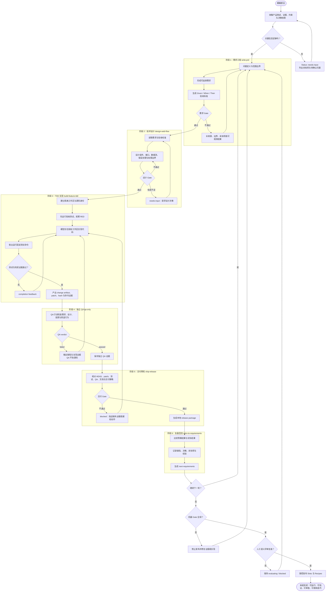
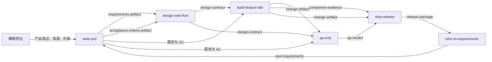
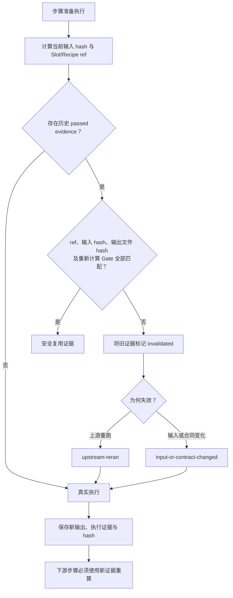
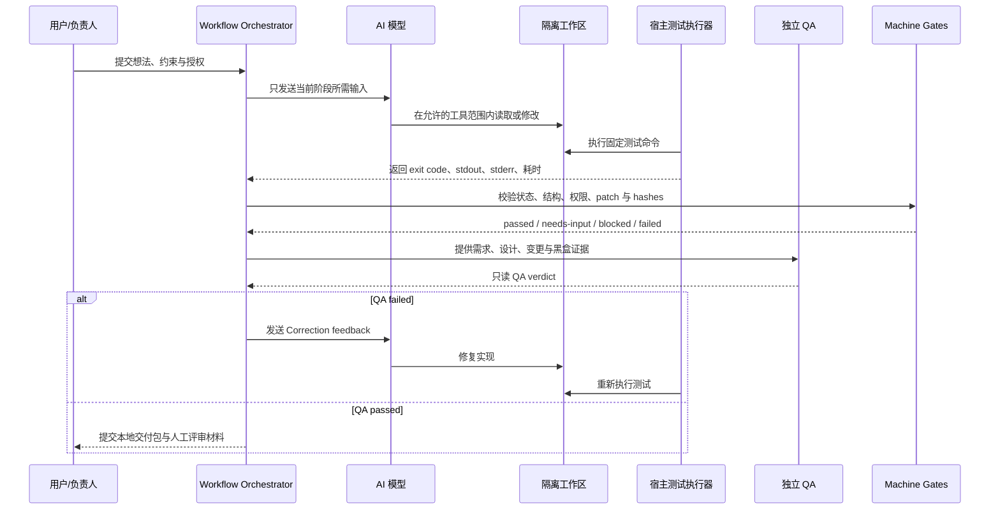
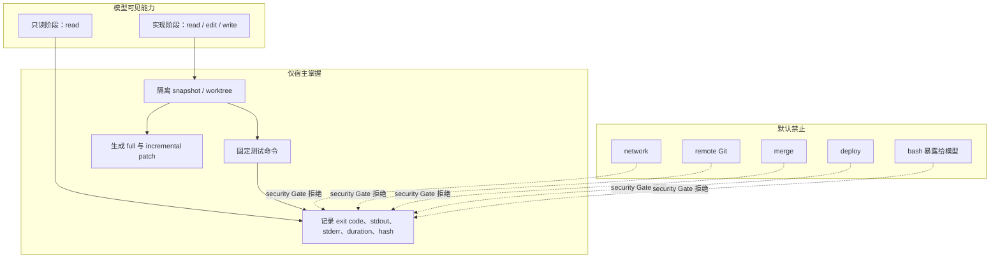
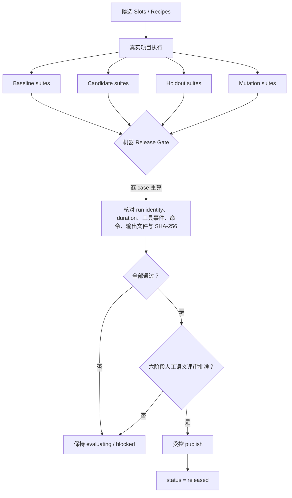
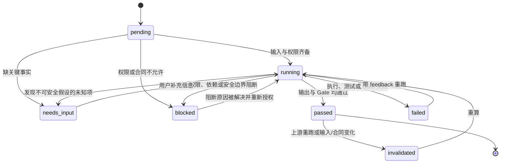
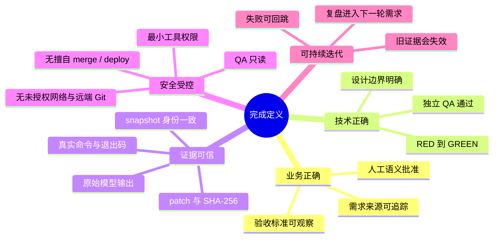
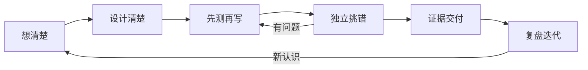

# Full Dev Loop：从模糊想法到完整系统

本文用图解释本项目已发布的 `full-dev-loop@1.0.0`。它不是“让 AI 一次性写完整个系统”，而是把软件开发拆成可验证、可返工、可审计的阶段。

> 核心规则：没有明确需求，不进入实现；没有真实执行证据，不算完成；QA 不替开发改代码；机器 Gate 与人工评审未同时通过，不得发布。

## 1. 一张图看完整流程



### 通俗解释

这条主线相当于六个角色接力：

1. **产品经理**：把“我想做个东西”变成明确需求。
2. **架构师**：决定系统应如何实现。
3. **开发者**：按测试驱动方式写代码。
4. **独立 QA**：专门找开发遗漏的问题，不能偷偷修代码。
5. **交付负责人**：检查是否具备安全交付条件，但不擅自 push、merge 或 deploy。
6. **复盘负责人**：把本轮经验变成下一轮输入。

## 2. 每个阶段实际交付什么



| 阶段 | 输入 | 主要输出 | 最关键的问题 |
|---|---|---|---|
| `write-prd` | 模糊想法、证据、约束、权限信息 | 需求、验收标准、需求 Gate 报告 | 到底要做什么，怎样才算完成？ |
| `design-web-flow` | 需求、验收标准、项目上下文 | 技术设计合同 | 如何实现，边界与失败路径是什么？ |
| `build-feature-tdd` | 需求、AC、设计、仓库、写入授权 | 代码变更、完成证据 | 是否先见 RED，再由真实测试证明 GREEN？ |
| `qa-only` | 需求、AC、设计、代码变更、QA 授权 | QA verdict | 开发者遗漏了什么？ |
| `ship-release` | 变更、测试证据、QA、仓库状态、交付政策 | 本地 release package | 是否真的具备交付条件，且没有越权？ |
| `retro-to-requirements` | 预期、实际、交付证据、决策、反馈 | 下一轮需求 | 本轮学到了什么，下一轮应改变什么？ |

## 3. 三条返工回路

系统并非一路向右，而是允许失败暴露后回跳。

```mermaid
flowchart LR
    I[实现] --> C{Completion Gate}
    C -- failed / needs-input -->|Correction feedback| I
    C -- passed --> Q[独立 QA]
    Q -- failed -->|qa-verdict 与复现证据| I
    Q -- passed --> S[交付预检]
    S --> R[复盘]
    R -->|next-requirements| P[下一轮需求]
    P --> I2[新一轮设计与实现]
```

- **实现内循环**：测试或完成证据失败，退回实现。
- **QA 回跳**：QA 只报告缺陷，由实现阶段修复，再重新 QA。
- **产品迭代循环**：复盘不是归档终点，而是下一轮需求入口。

真实 IP Rate Limiting 案例走过第二条回路：首版通过 6 项测试，QA 发现路由匹配过宽；扩展测试后出现 `1 failed, 11 passed`，退回修复，最终 `12 passed`。

## 4. 一次执行如何决定“复用、重跑或失效”



因此，旧测试报告不能证明新代码；上游一变，下游不能继续冒用旧结论。

## 5. 模型与宿主如何分工



最重要的分工是：

- **AI 负责推理和产出**，但不能自行证明自己成功。
- **宿主负责执行测试并记录事实**。
- **QA 负责独立找问题，但无权修改源码**。
- **机器 Gate 负责核对结构、权限和证据一致性**。
- **人负责判断业务语义是否真的正确**。

## 6. 权限与安全边界



注意：这里证明的是**模型工具层和执行合同层**的限制；它不冒充通用 OS 级网络沙箱。

## 7. 发布为何需要“两把钥匙”



机器判断“证据是否真实一致”；人判断“需求、设计和行为是否符合真正意图”。任一把钥匙缺失，不能发布。

## 8. 状态机：流程会停在哪里



`needs-input` 不是失败，而是系统拒绝脑补；`blocked` 表示当前权限或条件不允许继续；`failed` 表示已经真实尝试但验证失败。

## 9. 真实案例的运行轨迹


这条轨迹说明系统的价值不在于“第一次便完美”，而在于错误会暴露、返工有边界、修复后必须重新举证。

## 10. 如何判断“整套系统完全完成”



“完成”不是文件都生成了，而是：

```text
业务语义正确
× 实现和测试正确
× 独立 QA 可信
× 证据链可复算
× 发布获得授权
```

任何一项为零，整体都不应被称为完成。

## 11. 项目中的对应实现

| 机制 | 主要文件 |
|---|---|
| 六阶段总编排 | `recipes/full-dev-loop.json` |
| 需求 / 设计 / 实现 / QA / 交付 / 复盘 | `recipes/*.json` |
| 状态、恢复与证据复用 | `tools/curation/workflow_state.py`、`tools/curation/recipe_execute.py` |
| 隔离执行、宿主测试与 patch | `tools/curation/execution_adapters.py` |
| 安全边界 Gate | `tools/curation/full_dev_loop_security.py` |
| 完整证据清单 | `tools/curation/full_dev_loop_evidence.py` |
| 生命周期与回跳验证 | `tools/curation/full_dev_loop_lifecycle.py` |
| 复盘回流验证 | `tools/curation/full_dev_loop_feedback.py` |
| 最终发布 Gate | `tools/curation/full_dev_loop_release_gate.py` |
| 受控发布器 | `tools/curation/publish_full_dev_loop.py` |
| 真实运行证据 | `evals/runs/full-dev-loop/ip-rate-limiting-v1/` |
| 权威机器结果 | `curation/gate-report.json`、`curation/final-audit.json` |

## 12. 最简记忆版



一句话：**把模糊想法逐步变成需求、设计、代码、测试和交付证据；允许失败返工，但不允许未经验证便宣称完成。**
